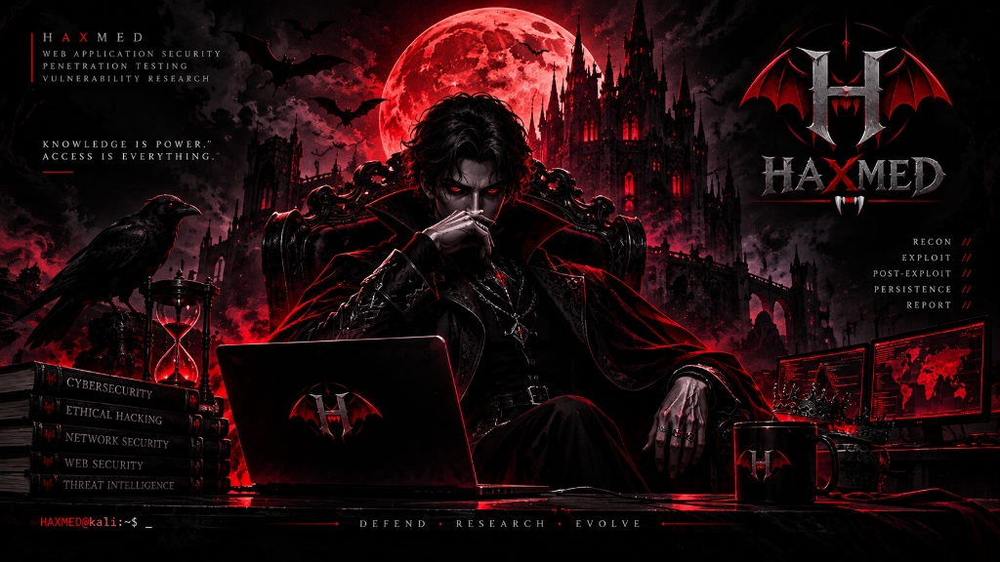

<div align="center">



<br /><br />

<a href="https://0xhaxmed.github.io/Mohamed_Heshame/">
  
</a>

<p align="center">
  <a href="https://0xhaxmed.github.io/Mohamed_Heshame/"></a>
  <a href="https://tryhackme.com/p/MohamedHesham.22"></a>
  <a href="https://www.linkedin.com/in/mohamed-heshame-093232300/"></a>
  <a href="mailto:mohamedhesham1033@gmail.com"></a>
</p>

<p align="center">
  <code>RECON // &bull; EXPLOIT // &bull; POST-EXPLOIT // &bull; PERSISTENCE // &bull; REPORT //</code>
</p>

</div>

---

## 🩸 Overview // What is this repository?

This repository contains the source code for the **official portfolio and personal offensive security portal** of **Mohamed Hesham (`HAXMED`)** &mdash; Junior Penetration Tester & Cybersecurity Specialist.

Hosted live on GitHub Pages:  
👉 **[https://0xhaxmed.github.io/Mohamed_Heshame/](https://0xhaxmed.github.io/Mohamed_Heshame/)**

---

## ⚔️ Visual Brand Identity & Technical Architecture

The design embodies a **Crimson Gothic Cyberpunk** aesthetic, reflecting deep offensive discipline and ethical exploitation.

| Element | Specification |
| :--- | :--- |
| **Primary Dark / Void** | `#070709` / `#0B0B0B` |
| **Blood Dark** | `#8B0000` |
| **Signature Crimson Accent** | `#C51F35` |
| **Neon Red Glow** | `#FF3352` |
| **Metallic Silver / Chrome** | `#BBB8BB` |
| **Typography** | `Inter` (UI/Display), `JetBrains Mono` (Terminal & Code) |
| **Motto** | *"KNOWLEDGE IS POWER. ACCESS IS EVERYTHING."* |
| **Status Tagline** | *DEFEND &bull; RESEARCH &bull; EVOLVE* |

---

## ⚡ Key Features

- **Interactive Canvas Particle Engine (`#bgCanvas`):** Custom HTML5 Canvas rendering floating crimson embers and interactive cyber constellation nodes that react to mouse dynamics.
- **3D Tilt Interactive Cards (`[data-tilt]`):** True 3D perspective transforms on project cards, skill modules, and the Kali terminal on hover.
- **Kali Linux Terminal Simulation:** Authentic bash prompt (`HAXMED@kali:~$`) running animated reconnaissance sequences with cursor blink.
- **Web3Forms Live AJAX Transmission:** Connected contact portal with client-side validation, honeypot spam filtering, and instant transmission without page reloads.
- **In-Page SPA Router:** Instant switching between overview and deep-dive technical case study views (`Silent Scraper Academy` & `HackX CTF`).
- **Verified Credentials Marquee:** Infinite-loop showcase of verified certificates (ITI 120hrs, Fortinet NGFW, HackX CTF, TryHackMe) with direct PDF access.
- **Full Accessibility (a11y):** Complete `prefers-reduced-motion` integration for neurodivergent and motion-sensitive users.

---

## 📂 Repository Structure

```
Mohamed_Heshame/
├── index.html                   # Main semantic entrypoint
├── README.md                    # Repository documentation
└── assets/
    ├── css/
    │   └── style.css            # Modular design tokens & responsive styling
    ├── js/
    │   └── main.js              # Canvas engine, 3D tilt, terminal & Web3Forms
    ├── images/
    │   ├── haxmed-emblem.svg    # Official vector bat-winged gothic 'H' emblem
    │   ├── haxmed-brand-board.jpg # Full brand color palette & social guidelines
    │   ├── haxmed-throne.jpg    # Gothic throne artwork
    │   ├── haxmed-lair.jpg      # Multi-monitor battle-station artwork
    │   ├── profile.jpg          # Profile portrait
    │   └── silentscrapers-logo.jpg # Project logo
    ├── certificates/            # Verified credentials images & PDFs
    └── documents/
        └── mohamed-hesham-cv.pdf # Latest penetration testing resume
```

---

## 🚀 Local Development

No build tools or heavy node dependencies required. Run directly in any modern browser:

```bash
# Clone the repository
git clone https://github.com/0xHaxmed/Mohamed_Heshame.git

# Navigate into directory
cd Mohamed_Heshame

# Serve using any local server (e.g., Python)
python -m http.server 8080
```
Open `http://localhost:8080` in your browser.

---

## 📬 Contact & Engagements

- **Email:** [mohamedhesham1033@gmail.com](mailto:mohamedhesham1033@gmail.com)
- **LinkedIn:** [Mohamed Hesham](https://www.linkedin.com/in/mohamed-heshame-093232300/)
- **TryHackMe:** [MohamedHesham.22](https://tryhackme.com/p/MohamedHesham.22)
- **GitHub:** [@0xHaxmed](https://github.com/0xHaxmed)

<br />

<div align="center">
  <sub><code>DREAM &bull; STUDY &bull; HACK &bull; ACHIEVE</code> &bull; &copy; 2026 HAXMED</sub>
</div>
